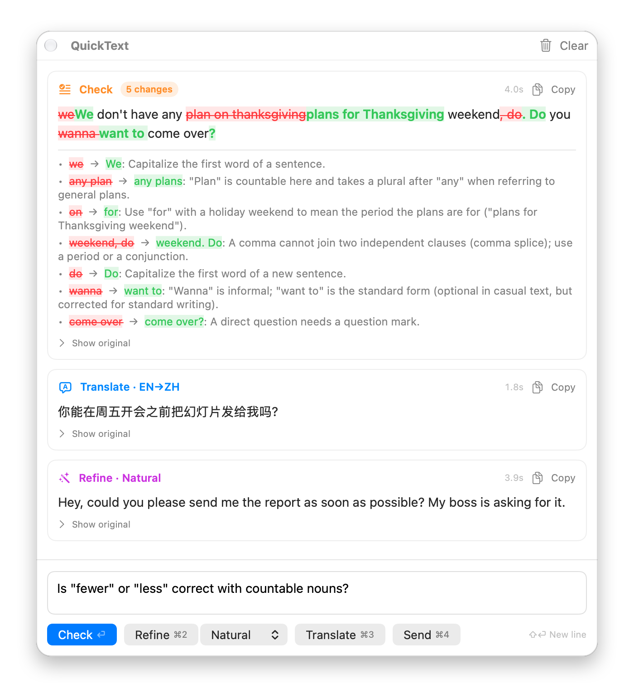
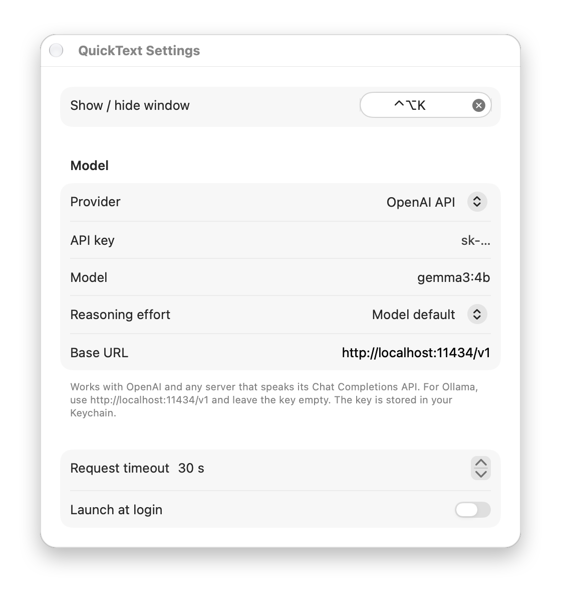

<div align="center">


# QuickText

**Fix, polish and translate any text with AI — one shortcut away, from any app on your Mac.**


<picture>
  <source media="(prefers-color-scheme: dark)" srcset="docs/images/window-dark.png">
  
</picture>

</div>

## Features

- **Check** — fixes grammar, spelling and punctuation, shows each change inline, and explains it so you learn from your mistakes.
- **Refine** — rewrites in one of five styles: Natural, Polite, Formal, Concise or Casual.
- **Translate** — Chinese ⇄ English, with the direction detected automatically.
- **Send** — a quick question box: your text goes to the model as is, with no prompt.
- **Any model** — Claude Code, Codex, the Anthropic API, the OpenAI API, or a local model through Ollama or LM Studio.
- **Private and permission-free** — no Accessibility or Screen Recording access; text stays in memory, API keys stay in your Keychain.

## Installation

You need macOS 14 or later and the Xcode Command Line Tools (`xcode-select --install`). Clone this repository, then from its folder run:

```bash
scripts/build-app.sh --install
```

This builds QuickText, copies it to `/Applications` and opens it. Then choose a provider:

| Provider | What you need |
|---|---|
| **Claude Code** (default) | [Claude Code](https://claude.com/claude-code), logged in with `claude auth login` |
| **Codex** | [Codex CLI](https://developers.openai.com/codex), logged in with `codex login` |
| **Anthropic API** | An API key from the Claude Console |
| **OpenAI API** | An OpenAI API key — or any OpenAI-compatible server, such as Ollama (`http://localhost:11434/v1`, no key) |

## Usage

Press **⌃⌥K** anywhere, type or paste some text, and press **⏎**. Click **Copy** on the result and paste it wherever you were.

| Shortcut | Action |
|---|---|
| ⌃⌥K | Show or hide QuickText (configurable) |
| ⏎ or ⌘1 | Check |
| ⌘2 · ⌘3 · ⌘4 | Refine · Translate · Send |
| ⌘⏎ | Repeat the last action on new text |
| ⇧⏎ | New line |
| Esc | Hide |

The window follows you to whichever screen the pointer is on, works over full-screen apps, and hides as soon as you click elsewhere. Results keep arriving while it's hidden.

## Settings



Open Settings with **⌘,** or from the menu-bar icon. Each provider remembers its own model, reasoning effort and key, so you can switch freely.

| Provider | Default model |
|---|---|
| Claude Code | `sonnet` |
| Codex | Codex's default |
| Anthropic API | `claude-sonnet-5-5` |
| OpenAI API | `gpt-6.1-terra` |

Command-line tools are found automatically in `~/.local/bin`, `/opt/homebrew/bin`, `/usr/local/bin` or your login shell's `PATH`; you can also choose the path yourself.

<br clear="right">

## How it works

QuickText sends one request per action. For Check, the model lists each change first and then writes the corrected text; QuickText diffs it against your original word by word (character by character for Chinese, Japanese and Korean) and shows the explanations underneath.

- **Command-line providers** run `claude -p` or `codex exec` in an empty folder, with your text on stdin. Claude Code runs without tools, MCP servers, skills or hooks; Codex runs in a read-only sandbox without saving the session.
- **API providers** make a single HTTPS request through an ephemeral session that caches nothing.
- Your text is wrapped in `<text>` tags with an instruction to treat it purely as content, so text that looks like instructions isn't followed. Send skips this.

## Privacy

- Text and results live only in memory and disappear when you press **Clear** or quit.
- API keys are stored in your login Keychain; other settings in `~/Library/Preferences/io.github.chyok.QuickText.plist`.
- Logs record exit codes, HTTP statuses and byte counts — never your text.
- Your text is sent only to the provider you chose.

<details>
<summary><b>Troubleshooting</b></summary>

| Message | Fix |
|---|---|
| Claude Code / Codex not found | Install it, or set its path in Settings |
| Your Claude login has expired | Run `claude auth login` |
| Codex isn't logged in | Run `codex login` |
| Add your … API key in Settings | Paste the key under Settings → Model |
| … rejected the API key | Check the key, its credit, and access to the model |
| Couldn't change Launch at Login | Move QuickText to `/Applications` first |

The app is signed ad hoc and not notarized. To run a copy built on another Mac, build it yourself or run `xattr -dr com.apple.quarantine QuickText.app`. After rebuilding, macOS asks once whether the new build may read the API key saved by the old one.

</details>

<details>
<summary><b>Limitations</b></summary>

- Results arrive all at once rather than streaming.
- Translate only goes between Chinese and English; Japanese kanji count as Chinese.
- With command-line providers, Send isn't fully context-free: Claude Code adds a short block of environment details and Codex keeps its base instructions. Use an API provider for a bare request.
- Small local models follow the Check format less reliably.
- The interface is English only.

</details>

## Development

```bash
swift test
```

The tests need neither the network nor any provider: command-line tools are replaced by shell scripts and HTTP by a stub `URLProtocol`. The project builds with just the Command Line Tools.

| Command | What it does |
|---|---|
| `swift run` | Run the app from the build folder |
| `scripts/build-app.sh` | Build `build/QuickText.app` (`ARCHS="arm64 x86_64"` for a universal app) |
| `swift scripts/make-icon.swift` | Redraw the app icon |

```
Sources/QuickText/
├── App/           entry point, app delegate, menu-bar menu
├── Panel/         the window: controller, model and SwiftUI views
├── LLM/           prompts, task runner, providers
│   └── Backends/  Claude Code, Codex, Anthropic and OpenAI
├── Text/          language detection, tokenizer, diff, Check parser
└── Settings/      preferences, Keychain, Settings window
```

Contributions are welcome — see [CONTRIBUTING.md](CONTRIBUTING.md).

## License

[MIT](LICENSE)
